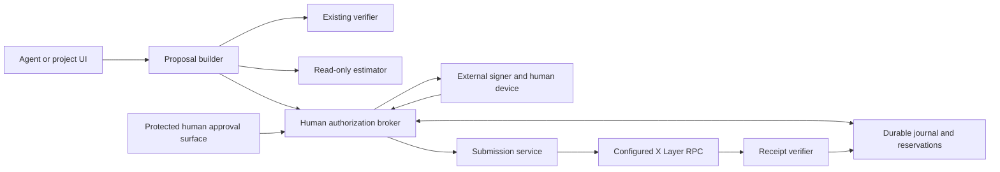

# ADR-M45-001 — Human-authorized X Layer tape-out

**Status PROPOSED. Version 0.1. Date 2026-11-19. Decision owner Founder.**
This design does not approve implementation, wallet access or live spending. Every normative requirement in this package describes a proposed future system.

## Evidence and scope change

Baseline main is `09f2482beae84be6d919ecd6957c4153d1924cca`. The two audit inputs are read at commit `962f5beeea9a485e8d4088ab1e67e0f8d69e6a27`, on the separate audit branch. They classify the lifecycle BLOCKED and the other five capabilities PARTIAL. Their offline demonstrations establish verification and interchange behavior, with no live publication or auditory screen-reader acceptance. [Gap audit](https://github.com/Technique-S/Flip/blob/962f5beeea9a485e8d4088ab1e67e0f8d69e6a27/docs/milestones/PRE_M5_CAPABILITY_GAP_AUDIT.md), [M4.5 plan](https://github.com/Technique-S/Flip/blob/962f5beeea9a485e8d4088ab1e67e0f8d69e6a27/docs/milestones/M4_5_ENGINEERING_PLAN.md)

If approved, this successor decision adds a separately authorized local transaction system to ADR-003's read-only scope. It supersedes only that exclusion for one allowlisted publication profile. The historical ADR, system architecture, technical design, MVP constraints, frozen contracts and M4 evidence remain immutable. M4 verification/pre-flight continue to operate read-only, with their existing limits and verdict semantics. Public solver and signer hosting remain outside the proposed accepted topology.

The first profile supports one existing registered processor, one stateless TAP-02 candidate and one ordinary externally owned account (EOA) on chain 196. New processor deployment, arbitrary calls, account delegation, automated agent custody, transfers, resource acquisition, allowances and batches are excluded from this profile. Future cancellation or fee replacement is a separately approved exact transaction. Read-only fee observations and structural acceptance remain distinct from successful publication.

## Component and authority boundaries

| Component | Input and responsibility | Output | Permitted authority |
|---|---|---|---|
| Project/composition service | Untrusted versioned project, source bytes and explicit maps | Validated deterministic circuit artifact | Edit/build only |
| Verification engine | Circuit artifact, reference/tests and limits | Recomputed proof/vector evidence | Existing bounded local execution; no transaction grant |
| Proposal builder | Validated artifact, selected sender/target, policy profile | Immutable intent under Approval Protocol v0.1 | Prepare only; no signer/submission handle |
| Fee/resource estimator | Allowlisted read RPC, real sender, target ABI and pinned observations | Versioned quote, sufficiency, bounds and unknown fields | Reads only, bounded requests |
| Human authorization broker | Immutable intent, policy, protected human interaction | One-use grant and atomic resource reservations | Exclusive authority to permit signing and dispatch |
| External signer | Broker-authenticated exact payload and human device confirmation | Signed raw transaction | Wallet key operation only; no auto-submit |
| Submission service | Durable signed payload and broker dispatch permit | Hash/transport outcome | Only approved raw bytes to configured chain endpoints |
| Durable reconciliation journal | Intent/grant/job events, reservations and receipts | Recoverable state and compare-and-swap transitions | Authoritative persistent policy state; agent has read-only redacted view |
| Circuit receipt verifier | Transaction/block/log evidence and imported circuit bytes | Versioned verified receipt or discrepancy | Reads only; cannot mint an approval |

The journal is owned by the broker and available to its controlled reconciliation worker. No agent or verification process can write a grant, impersonate an approver, mutate policy, read raw signed bytes or invoke the signer/submission transport directly. Distinct services can share a trusted broker process where appropriate, but the agent-facing API and human authority must remain separate security principals.

Existing localhost/Host/origin protections protect the local service from some web requests. They do not distinguish an authorized human from an agent with computer-control tools. A broker served to the same unrestricted OS principal is insufficient. The proposed supported deployment therefore requires a separate broker OS identity or human-controlled device, protected approval UI, hardware user presence and ACLs that exclude the agent. If those cannot be established, signing stays disabled. A broadly privileged agent controlling the broker host and human UI is outside this threat model and cannot be granted transaction access safely through a checkbox.

## Recommended signer/account model

Recommend a dedicated, locally controlled hardware-backed EOA, with keys held by a human-controlled external signer and a reviewed raw-signing adapter. The adapter must return signed bytes before any network submission. The broker independently decodes those bytes, recovers the sender, verifies all exact fields and persists the result before dispatch. A hardware button alone does not certify calldata semantics. The trusted signer application must independently decode the ABI and compare the approved artifact. Blind confirmation of an opaque payload fails the acceptance gate.

Support initially one enrolled account/chain per job. Reject smart accounts, multisig execution, session keys, delegated EOAs and transaction types not explicitly profiled. Check sender code/delegation status through the reviewed account adapter. Out-of-band use of this account invalidates nonce assumptions and triggers reconciliation. Recommended account isolation reduces that risk; it cannot prevent the owner using the wallet elsewhere.

### Wallet approaches considered

| Approach | Assessment and decision |
|---|---|
| Hardware-backed EOA with local external raw signer | Recommended profile, subject to exact device/firmware/application and chain tests. Best separation of key custody, human presence and broker-controlled dispatch |
| OKX extension/mobile EVM provider | Realistic X Layer candidate for later integration. Its documented send path initiates transactions through eth_sendTransaction and exposes editable gas fields. The reviewed documentation does not establish a raw-sign-only capability satisfying this profile. Compatibility remains unverified |
| Other injected EIP-1193 wallet or WalletConnect session | Potential transport, not a permission model. Chain/account events are useful, but raw signing, exact-field preservation, session scope and disconnect behavior require current product testing |
| Software keystore or unlocked node reachable by the agent | Rejected initial profile. Key extraction/unattended signing can bypass the human boundary |
| Agentic hosted custodial wallet or session spending key | Rejected initial profile. Delegates authority to the agent/provider and expands secret, spend and recovery trust |
| Smart account/multisig or onchain execution guard | Deferred separate profile. Can enable stronger execution checks, but introduces contract, deployment, signature and gas semantics requiring independent review |
| Manual unsigned payload export to an arbitrary wallet | Useful diagnostic transport only. Unverifiable field edits or hidden auto-broadcast cannot satisfy broker-controlled dispatch |

No specific wallet/device/provider is certified by this design. Ethereum's execution API describes a raw signing method, but support must be demonstrated for the selected signer; a standard's existence is insufficient. [Execution API raw signing](https://ethereum.github.io/execution-apis/api/methods/eth_signTransaction/)

Current official network documentation lists chain 196 and OKB. EIP-1193 describes account/chain change events, which should invalidate an active wallet context if that transport is selected. Official OKX send documentation supports the assessment above. These were documentation checks on 2026-11-19, without a wallet connection. [X Layer network](https://web3.okx.com/onchainos/dev-docs/xlayer/developer/build-on-xlayer/network-information), [EIP-1193](https://eips.ethereum.org/EIPS/eip-1193), [OKX transaction interface](https://web3.okx.com/onchainos/dev-docs/wallet/dapp-connect/chains/evm/web-send-transaction)

## Execution-time limits that pre-sign checks cannot enforce alone

An EOA transaction does not carry an application expiry or automatically enforce an approved implementation hash/token burn cap. A mutable processor, factory, beacon or resource contract could change after the final read and before inclusion. Receipt checking would detect harm after execution. The default live profile must therefore require either verified immutability of the relevant execution context or an independently reviewed atomic onchain guard enforcing the approved context and resource limits. A boolean factory seal is not assumed to cover all relevant mutability without protocol evidence. No guard contract is implemented or authorized by this milestone. Founder decision D10 is a live gate.

Likewise, the complete network fee model must be verified. The usual execution gas ceiling may not cover every chain-specific fee. Unknown/unbounded additional fees block live activation under a strict total spend policy. A dedicated account balance is a loss containment measure, not proof that an approved cap is enforced.

## Contract and rollout strategy

The [approval protocol](FLIP_APPROVAL_PROTOCOL.md) defines separate proposed version-0.1 intent, quote, grant, dispatch and receipt contracts in documentation. They will require new versioned schemas before implementation. No frozen v1/M2/M3 contract changes are proposed in place. Importing a project or replaying a proof never creates an authorization. Active grants and raw signed payloads are excluded from portable project exports.

Recommended rollout follows M4.5-0 design review, M4.5-3 read-only quotes/previews, M4.5-4A broker/journal with doubles, M4.5-4B reviewed signer adapter and M4.5-5 separately approved live acceptance. Development tests use synthetic data and isolated local chains. Release enablement and each live operation require distinct decisions.

Approval requires the [decision register](../milestones/M45_0_DECISION_REGISTER.md), all automated/manual/live gates in the [threat model](FLIP_TRANSACTION_THREAT_MODEL.md), and a reviewed [state machine](FLIP_TRANSACTION_STATE_MACHINE.md). Until then every component above is a proposed responsibility, not production functionality.
