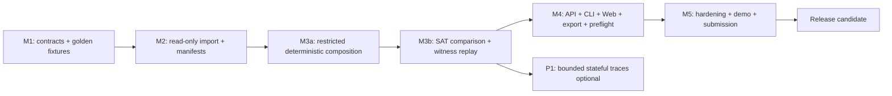

# FLIP — Implementation Dependencies, Milestones and Engineering Gates

**Version:** 1.0 proposed delivery plan  
**Date:** 2026-11-16  
**Source documents:** Product Decision Brief and PRD (historically “CircuitForge”), M0/M0.5 evidence, `MVP_CONSTRAINTS.md`, and Flip architecture documents.  
**Calendar assumption:** Hackathon deadline reported as **2026-12-07 23:59 UTC**, subject to rechecking official rules; do not treat this report-derived date as independently reconfirmed in this architecture document.

## 1. Critical path

**Hard rule:** No user-facing status or proof is trusted until its source validation, manifest and solver/witness contract are implemented. API/UI may use fixtures or explicit placeholders while core is being built, but must not fake verified results.

## 2. Dependency map by component

| Component | Must wait for | May proceed in parallel | Definition of done |
|---|---|---|---|
| Schemas + canonical JSON | PRD + audit constraints | Raw fixture provenance collection | JSON Schema and Pydantic models, 100 deterministic hashes, TS codegen matches canonical examples |
| Chain adapter | schema / error codes | Web static shell; malformed fixtures | ChainId 196 read-only, correct ABI and pinned block, audited XOR/NAND match |
| TAP-02 parser/simulator | source bytes + golden vectors | CLI docs; UI sample visuals | 18 vectors pass; corpus parity when raw inputs available; malformed blocks rejected |
| REF resolver | chain adapter + parser | dependency negative fixture generation | Bounded closure, cycle/registration checks, no cross-chain confusion |
| Manifest/integrity | chain snapshot + resolver + canonical JSON | 9 negative fixture collection | All 9 mutations rejected, stale/current statuses correct |
| Composer | schema + parser + resolver | new test vectors and examples | 81-byte half-adder fixture, 4/4 truth table, 100 deterministic runs |
| Canary CNF and solver worker | parser + REF closure + comparison schema | independent mutation corpus/benchmark generator | 28/28 audit fixtures and safeguard cases; witness replay; UNKNOWN timeout; hard worker limits |
| Pre-flight | chain adapter + manifest + compiler | static UX copy | Fresh-fee read-only structural classification; unknown revert stays unknown |
| Export | schemas + manifest + compare | export docs and proof-example content | portable artifact, hashes, no zip traversal, CLI replay |
| CLI | core contract + progressively complete modules | CLI examples/checklists | JSON and stable exit codes, same normalized report hash as API |
| API service | core contract + worker | OpenCode UI presentation components | thin routes, no signer/write RPC, worker isolation, no project persistence |
| Web application | frozen OpenAPI schemas + basic API | OpenCode presentational components/docs | sample/import/compose/compare/evidence/preflight, accessible errors, no false claims |
| User validation | working integrated sample | documentation/demo preparation | actual developer sessions recorded; no claims inferred from targets |
| Hackathon submission | public web/demo + current official rule check | independent submission checklist | required proof and links verifiable; separately authorized circuit publication if required |

## 3. Milestones with targets and explicit cut lines

The dates below are a **proposed schedule**, not delivery promises. They assume immediate start and roughly three weeks to the reported deadline. No background work is taking place under this plan.

| Milestone | Proposed window (2026) | Required result | No-go or adjustment |
|---|---|---|---|
| **M1** Contracts + corpus | Nov 17–19 | Frozen project/report/manifest schemas and CLI class codes; provenance-labeled raw fixtures available; clean bootstrap | If raw audit scripts missing, create verified substitute fixtures from read-only RPC; mark originals unavailable, never invent |
| **M2** Import + integrity | Nov 20–23 | Live reads, TAP-02 validation, REF closure, canonical manifest; all 9 negative fixtures | If RPC inconsistent, pin offline snapshots and separately isolate live verification; do not present cached as current |
| **M3** Compose + Canary | Nov 24–28 | 81-byte half-adder, refactor SAT diff, witness replay; 2,500/5,000 caps and worker hard limits tested | If 64MiB cap not enforceable publicly, block public solver or choose alternative isolation via ADR |
| **M4** Both interfaces | Nov 29–Dec 3 | Web + CLI parity, guided sample, export, read-only pre-flight; deployed staging | Cut optional visual graph/local persistence polish before web/CLI parity |
| **M5** Acceptance + submission | Dec 4–7 | Full regression, adversarial cases, manual pilot where available, public demo, official rules confirmation | If required new circuit ID and transaction not authorized, report release/submission blocker explicitly |
| **M6** P1 trace diff | After P0 green only | Bounded 8-beat stateful feature | Cut entirely if any P0 gate at risk |

**Delivery ordering caveat:** M3 may start parser/compiler groundwork before every M2 live RPC integration is complete, using trusted pinned fixtures, but any claim of a fresh onchain result waits for M2.

## 4. Required engineering gates and failure policy

| Gate | Acceptance | Evidence file/test |
|---|---|---|
| G-01 Canonical contract | Project roundtrip, exact hash normalization, unsupported schemas rejected, JS bigint not truncated | schema golden vectors + `pytest` + TS tests |
| G-02 TAP-02 parity | 18 official vectors; audited real circuit fixture results (when full raw data available) | vector matrix; raw fixture hashes |
| G-03 Read-only X Layer | Correct chain ID; ABI, pinned context; wrong-chain test | RPC calls and saved block/hash |
| G-04 REF integrity | All nine negative cases + hostile recursive REF bounded | test output and manifest diff |
| G-05 Composition | 81-byte netlist, four truth-table rows, repeated build determinism | compiler fixture output |
| G-06 Canary semantics | 28 expected scale outcomes, witness replay, timeouts UNKNOWN, intent qualification | solver matrix incl 7 safeguards |
| G-07 Runtime limits | Kill/contain 5s and 64MiB worker on actual release target | worker stress evidence and clean process reap |
| G-08 CLI/API parity | Same project yields same normalized verdict, manifest and candidate netlist | parity harness / canonical digest |
| G-09 UX reliability | Sample unassisted flow, invalid input and RPC failure states, keyboard completion | Playwright + manual spot checks |
| G-10 Pre-flight honesty | Burn-stage known revert classified structural only; unknown revert UNKNOWN | replayable read-only test |
| G-11 Release completeness | Public HTTPS app, CLI install, evidence artifacts, current hackathon rules reviewed | demo and release checklist |

**Blocking gates:** G-01 through G-08 and G-10 must pass for P0 technical acceptance. If G-09/G-11 fail, product cannot be called release-ready, though technical core may remain feasible. Tests must not be weakened to force completion.

## 5. De-risking decisions at each phase

### At M1 (before code parallelism)
- Choose exact Python version and solver binary licensing/packaging. Freeze canonical JSON semantics, byte order, ABI provenance, report types, CLI exit codes and error taxonomy.
- Test whether the original audit **raw** fixtures and experiment scripts are actually available to both agents; uploaded markdown summaries alone cannot recreate all raw transactions and witnesses.
- Create fixture provenance statuses (`RAW_REPLAYED`, `READ_ONLY_REGENERATED`, `REPORT_ONLY`). Only first two count as automated regression inputs.

### At M2
- Revalidate X Layer factory/beacon/current fee, and register block-pinned chain identity. Limit RPC calls, cache snapshots by content and environment.
- Confirm the root chain reader never executes user-specified URLs or write methods.

### At M3
- Confirm actual SAT resource usage under production worker limits; a service process that can exhaust memory cannot ship even if isolated Python benchmarks looked small.
- Enforce `UNKNOWN` on killed worker, resource cap or replay failure. Add tests that intentionally break a solver witness.

### At M4
- Validate web processing consent language and CLI parity. Make `HISTORICAL` versus `CURRENT` freshness visible alongside proof.
- If server uptime/limits prove unsatisfactory, keep local CLI functional and reevaluate hosting with a formal ADR; don't silently drop web v1.

### At M5
- Run human pilot tasks and record what was observed. Confirm the official 2026 hackathon eligibility and submission mechanics. Decide whether separately authorized onchain publication is required for submission; no funds are authorized in these docs.

## 6. Agent parallelization schedule

| Milestone | Codex owned task | OpenCode parallel task | Start condition |
|---|---|---|---|
| M1 | Schemas, canonical hashing, scaffold | Report/fixture provenance + source completeness index | Repo + same base commit |
| M2 | Chain/REF/manifest implementation | 9 negative fixture files + hostile input catalog | Schema `1.0.0` frozen |
| M3a | Composer + parser/evaluator parity | Independent half-adder regression fixture checks | Core type definitions frozen |
| M3b | SAT + isolation + witness replay | Mutation suite, memory/timeout benchmark harness | Comparison schema and solver input contract frozen |
| M4 | CLI/API/Web integration | CLI docs, sample tutorial, isolated results UI, parity fixtures | OpenAPI/props contracts frozen |
| M5 | Integration/security/release | Independent QA, accessibility, user-study facilitation, demo narrative | Staging product accessible |

Integration always belongs to Codex. OpenCode outputs are reviewed as untrusted contributions and may be rejected without weakening acceptance standards.

## 7. Estimated engineering effort and uncertainty

**Estimates, not commitments:** On a single active primary coding-agent stream with intermittent OpenCode support, M1 ~1–3 focused engineering days; M2 ~3–5; M3 ~4–7; M4 ~4–6; M5 ~2–4. These ranges overlap in calendar if independent fixtures/docs run in parallel. The proposed 21-day window is tight. Large unknowns are native solver host containment, preserving TAP-02 semantics through porting, actual RPC availability, and UI/CLI parity. Do not add work merely to hit dates; fail or revise when critical gates remain unmet.

**Minimum viable submission path:** A complete stateless sample demonstrating real imported circuits, deterministic restricted composition, meaningful refactor counterexample, corrected EQUIVALENT result, trusted evidence bundle and web/CLI parity, with honest read-only chain pre-flight. No generic editor; no stateful proofs; no wallet.

## 8. Release prerequisites and human decisions

- **Founder/product sign-off:** Approve these architecture choices and P0 priorities before start of M1, or request targeted ADR changes.
- **Engineering:** Verify deployment target can enforce solver limits; select locked distributions and CI runners; promote audit evidence with raw file hashes.
- **User testing:** At least five qualified TapeOut developers targeted; actual completed count and usability issues recorded transparently.
- **External compliance:** Re-check live hackathon rules. If submission needs new circuit minted, review resources and spend separately; existing read-only work has not proven transaction success or actual gas/transistor acquisition cost.
- **Security:** Public server hardening and no-key/no-broadcast regression scan must pass.

## 9. Implementation start order

1. Initialize protected monorepo and copy approved docs/evidence without changing original audit files.
2. Start the **Codex M1-A** and **OpenCode M1-B** prompts in `FLIP_AGENT_OWNERSHIP_MATRIX.md` with separate worktrees and non-overlapping paths.
3. Codex freezes the shared schema and merges audited OpenCode fixture PR only after provenance review.
4. Begin M2 and continue using milestone pairing rules. Stop at any failing critical gate.

## 10. Traceability

M1 maps to PRD FR-003/004/040/060/061; M2 to FR-010–015/040–042; M3 to FR-020–031; M4 to FR-001/002/043/050–052/060–063; M5 to NFRs and AT-01–14; M6 to FR-032 only. `MVP_CONSTRAINTS.md` remains the overriding hard boundary for chain, circuit types, proof semantics, solver limits, manifest provenance, pre-flight statuses and exclusions.
