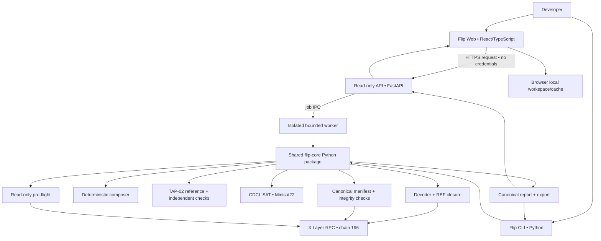

# FLIP — System Architecture

**Version:** 1.0 proposed implementation baseline  
**Date:** 2026-11-16  
**Status:** Architecture-ready; engineering verification gates still apply  
**Name:** Flip (formerly CircuitForge; retain historical M0/M0.5 names in evidence)  
**Sources of authority:** `CircuitForge_PRD_v1.md` (approved product selections), `MVP_CONSTRAINTS.md` (hard technical boundaries), `FINAL_HANDOFF.md`, `FINAL_VERDICT.md`, `SECURITY_REVIEW.md`, `INTEGRITY_VERIFICATION.md`, `WIRING_CANARY_SCALE.md`, `PUBLICATION_READINESS.md`, and M0 audit evidence. Where this architecture adds a choice, it is marked **DESIGN DECISION**, not represented as audit-verified.

## 1. Mission, user and system boundary

Flip serves **TapeOut application integrators first** and circuit authors/maintainers second. Its flagship job is to import existing X Layer TapeOut circuits, compose a restricted REF-based candidate, compare the candidate to a trusted baseline or declared expectations, and generate a reproducible explanation of any behavioral difference. Its web application and CLI both use **one verification engine and one report contract**.

Core promise: **Compose. Compare. Verify. Preserve the evidence.** This is a verification product, not a general-purpose logic drawing program.

### Required behavior

- X Layer **mainnet chainId 196 only**; read-only chain operations; no wallet, signer, raw transaction construction or broadcasting.
- Stateless TAP-02 netlists have exact SAT-backed pairwise equivalence / counterexample results within supported limits. Bounded 8-beat stateful trace difference is **P1 only**.
- Canonical chain-/environment-bound manifests are required at every verified result; historical proof and live freshness are separate claims.
- Pre-flight status only `STRUCTURALLY_ACCEPTED`, `REJECTED` or `UNKNOWN`. A revert at the documented transistor-burn stage is *not* a successful publication.
- Developer can run a bundled sample without account or wallet and use CLI commands to reproduce the same outputs.

## 2. Deployment topology (design decision)

Choose **Python verification-core + Python CLI + stateless Python API + React/TypeScript web client**, in a monorepo. This avoids duplicating TAP-02 semantics and leverages the independently tested Python evaluator and native Minisat22 bindings. For the public web UI, computation runs in an **isolated server-side worker**. CLI execution is local. Browser state and cached snapshots are local-first, while web verification is **explicitly server-processed**. Disclose network upload of projects/netlists to users before running web verification; offer CLI as an offline alternative for fixture-based use.

The phrase “local/cache-first simulation” in M0.5 means avoid repeated remote **blockchain** calls and run circuit computation near the verification engine. This architecture does **not** promise browser-offline SAT. Native-web parity and actual sandbox constraints are release gates.

**Data/control boundaries:**
1. Browser may store user project snapshots locally; the web API is stateless by default and accepts bounded requests explicitly submitted by the user.
2. The API does not hold keys or perform signing. It only invokes an allowlisted RPC **read** adapter; its RPC target is configured by deployment, not arbitrary user-supplied URLs (avoid SSRF).
3. Each untrusted project is validated before use; SAT work runs out of process with OS-enforced memory/time limits; a timeout maps to `UNKNOWN`.
4. CLI imports the same `flip-core` package in-process and launches the identical bounded solver worker. CLI and web must share the same semantically versioned engine.
5. Network and execution provenance are embedded in artifacts, without implying multi-RPC consensus or malicious-provider protection.

## 3. Component map and ownership

| Component | Responsibility | Inputs | Outputs | Owner |
|---|---|---|---|---|
| `flip-schema` (Python models + generated JSON Schema/TS types) | Versioned project, manifest, report and error contracts; canonical encoding | untrusted JSON and bytes | validated models, schemas | Codex |
| `flip-chain` | Chain-ID check, ABI-validated read-only contract calls, pinned block, registered REF lookup | `(196, processor, id)` | raw netlist and observed contract state | Codex |
| `flip-tap02` | Strict binary parser, structural validator, beat evaluator and resource budgeting | netlist bytes, REF resolver | typed nodes, outputs / errors | Codex |
| `flip-refs` | Bounded, memoized REF DAG closure | parsed REF links | closure, identities, totals | Codex |
| `flip-manifest` | Canonical provenance, beacon/factory codehash and freshness revalidation | pinned chain snapshot + dependencies | manifest/digest/freshness | Codex |
| `flip-compose` | Explicit numeric pin mapping, restricted glue NAND, deterministic topological ordering, output placement | graph + source circuits | candidate netlist + warnings | Codex |
| `flip-canary` | Stateless miter/CNF encoder, CDCL solve, witness replay, conservative minimization | reference/candidate+map | EQUIVALENT/DIFFERENT/UNKNOWN | Codex |
| `flip-preflight` | Fresh fee/implementation recheck, documented structural read-only call, explicit revert decoding | candidate + manifest | structural pre-flight verdict | Codex |
| `flip-export` | Reproducible, self-describing evidence bundle and digest | validated project/report | archive, README, hashes | Codex |
| `flip-cli` | Inspect/compose/compare/preflight/export, stable JSON and exit codes | files/flags | machine-parseable results | Codex core; OpenCode CLI tests/docs |
| `flip-api` | Thin HTTP endpoints, limits, worker isolation, rate limits | validated JSON | same core report | Codex |
| `flip-web` | Guided sample/import/compose/compare/evidence flow, accessible UI | user actions | UX and report export | Codex integration; OpenCode isolated components |
| fixtures/tests/docs | Independent parity, negative fixtures, threat cases, tutorials | frozen contracts | test reports | OpenCode with Codex review |

## 4. End-to-end sequence

### J-03 flagship: refactor/behavioral comparison

1. Web starts from a pinned sample or imports live circuit identities. Display `HISTORICAL_SAMPLE` vs `LIVE_OBSERVED` conspicuously.
2. User specifies numeric port mapping and a restricted candidate composition. Importer verifies `eth_chainId=196`, registry/circuit existence and all dependency bounds, then pins a consistent block.
3. Composer emits deterministic TAP-02 bytes, with no forward references except allowed LATCH `d` if P1.
4. User selects **reference circuit / previous revision** or provides truth-table vectors. Mode C permits pairwise behavioral diff between explicitly supplied circuits but cannot assign which is correct.
5. Manifest verifier confirms source bytes, dependency closure, factory/beacon implementations and current freshness before a result is marked current. Offline snapshots yield *historical* rather than *current* status.
6. For **two stateless circuits with a complete model**, Canary constructs a SAT miter. `UNSAT` → pairwise `EQUIVALENT`; `SAT` → replay witness via independent evaluator before `DIFFERENT`. Timeout/limit/replay mismatch → `UNKNOWN` with reason.
7. A supplied vector oracle instead returns `VECTORS_MATCH` / explicit mismatch, without claiming universal proof unless exhaustive coverage is established.
8. User exports deterministic netlist, project, manifests, oracle, result, witness and reproduction instructions.
9. User may perform separately requested **read-only pre-flight** on fresh chain state. Never show `PUBLISHED`.

### Failure paths

Wrong chain, nonexistent circuit, ABI mismatch, invalid REF, nested dependency exhaustion, changed beacon implementation, lack of oracle, SAT timeout, unknown RPC revert and storage-override limitation all preserve the user's project and yield a typed, actionable failure. There is no path that converts an infrastructure failure into `EQUIVALENT`.

## 5. Trust model and invariants

**Untrusted:** user project JSON, netlists, user labels/oracles, RPC responses, cache, third-party source code and download artifacts. **Controlled:** package binaries, schema validators, isolated solver worker, configured RPC endpoint, deterministic serialization. **Not guaranteed:** RPC honesty, upstream protocol immutability, intent correctness, non-tested stateful equivalence, deployment success.

Critical invariants:

- `chainId` checked at session start and before any fresh pre-flight; hard reject non-196.
- Source identity is `(chainId, processor address, uint256 circuit ID, netlist hash, pinned block, dependency/environment hashes)`; address alone is never enough.
- No verified fresh report without successful manifest revalidation at the observation point.
- Same canonical project + same pinned manifests + engine/semantics + limits → same normalized proof content hash; timestamps and wall-clock metrics are outside digest.
- Only SAT UNSAT for fully modeled stateless comparison yields `EQUIVALENT`; SAT witness must reproduce independently to yield `DIFFERENT`.
- Statefulness never silently falls back to a stateless proof. P1 returns only trace-scoped results.
- Pre-flight success language limited to structural checks; burn-stage resource failure isn't full success.
- The web server executes **no** write RPC and accepts **no** signing credentials.

## 6. Cache and data retention

- **Browser:** optional IndexedDB/localStorage project drafts and public circuit snapshots; quota errors handled. Avoid storing private information by default.
- **CLI:** local content-addressed cache, explicit `--offline` mode for fixtures, user-controlled path.
- **API:** cache validated **public chain data** by chain ID + processor + id + netlist/environment hashes; use a bounded in-memory/disk cache without persistent user projects. Short-lived job data removed on completion/timeout; log only operational metadata (no raw project or counterexamples by default).
- Cache freshness check compares new pinned chain state to persisted manifest; record changed codehash/REF identity as `STALE` without erasing historical reports.
- No claim of resistance to a malicious RPC based on a single provider.

## 7. Public web service hardening

- API request body and archive size caps, strict schema parsing, single network allowlist, explicit RPC timeouts, concurrency and per-IP quotas, worker process isolation, worker cancellation, temp-file cleanup and rate limiting.
- Hard 5-second solver budget and 64 MiB solver-worker address-space/memory budget; account for platform-specific enforcement. If hard enforcement cannot be verified on the deployment platform, the public solver endpoint is not production-ready.
- Auth not required for launch; no server-backed account data. Protect public endpoint from resource abuse with quota; do not treat quotas as identity or trust.
- Frontend shows explicit server-processing notice; no claim that projects never leave device. CLI can work locally with pinned fixtures and optionally connect to X Layer for fresh reads.

## 8. Deployment and operations

- Web static assets via HTTPS CDN/static hosting; Python API on isolated server/container with configured outbound HTTPS to X Layer RPC. Public custom RPC URLs are **not accepted** server-side.
- Container image digest pinned, Python dependencies locked, worker native binaries packaged reproducibly, SBOM/security check, health endpoints separate from verified output.
- CI runs source-quality, M0/M0.5 fixtures, mutation/negative, API, CLI, UI E2E, cross-interface canonical artifact parity, and live read-only smoke tests (isolated from deterministic offline CI).
- No secrets needed for baseline RPC; only optional infrastructure-specific keys in deployment secrets, never user wallets.

## 9. Architecture release gates

| Gate | Must demonstrate |
|---|---|
| AG-01 | Python core can reproduce 18 official TAP-02 vectors; 35-circuit corpus where fixtures available; mismatches fail build |
| AG-02 | Half-adder 81 bytes, 100 deterministic builds, 4/4 truth table; invalid connections rejected |
| AG-03 | Canary 28/28 scale regression cases and all 7 safeguards, witness replay, UNKNOWN on timeout |
| AG-04 | All 9 manifest negative fixtures fail appropriately; fresh vs stale separated |
| AG-05 | Web/API vs CLI normalized reports, netlists, manifest digests identical for pinned fixture |
| AG-06 | Worker timeout **and** memory kill demonstrably enforced on the deployed environment |
| AG-07 | Pre-flight known burn error = `STRUCTURALLY_ACCEPTED`; unknown revert = `UNKNOWN`; no write RPC path |
| AG-08 | Public web sample and clean-machine CLI complete flagship journey; accessibility smoke |
| AG-09 | Official hackathon submission checklist verified independently before final release; any external onchain publication requires separate owner approval |

## 10. Open engineering proofs (not blockers to architecture)

- Validate `python-sat`/Minisat22 license and deployment packaging under selected target OS/CPU, and produce clean-machine install + parity benchmark. Audit reported native Python package performance, not web-server performance.
- Check production ability to enforce the per-job 64 MiB ceiling; bare Python `tracemalloc` isn't a hard RSS constraint.
- Confirm accurate ABI signatures/selector decoding with independently checked golden fixtures; preserve audit evidence but do not take previous handwritten ABI constants on faith.
- Decide if official submission requires a newly minted onchain circuit ID. Read-only tool architecture doesn't perform publication; any sanctioned external transaction is separate.

## 11. References

Source docs: `CircuitForge_PRD_v1.md` FR-001..063, NFR-01..12, AT-01..14; `MVP_CONSTRAINTS.md` §§1–10; `FINAL_HANDOFF.md` findings 1–5; `FINAL_VERDICT.md`; `WIRING_CANARY_SCALE.md`; `INTEGRITY_VERIFICATION.md`; `PUBLICATION_READINESS.md`; `DIFFERENTIATION_REPORT.md`. These files are historical evidence and keep the CircuitForge label where present. New product identity and end-user copy use **Flip**.
