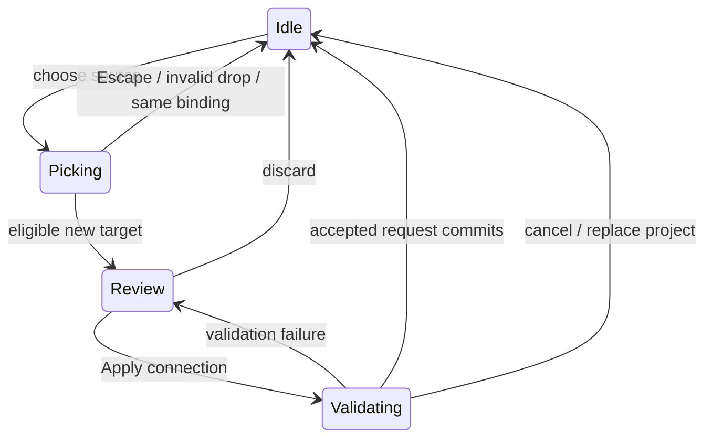

# P7-V2-B canonical wiring contract — architecture checkpoint

Status: PROPOSED, not implemented or authorized for implementation. Accepted baseline: **`2fa7281ba01557f484cef2878e484b6e16f3ffd2`** (PR #14 merge). Reviewed V2-A: `036c7a99f26d87dd4366762c8c3c059ac8e3d65d`; production implementation: `b23d3dcf8f98e9b95cd0bc8ca8fbf612045e1daa`. Post-merge observations and planning-commit identification live in the [checkpoint record](../milestones/P7_V2_B_ARCHITECTURE_CHECKPOINT.md). This document does not supersede frozen schemas, historical evidence or security controls.

## Authority and current behavior

The canonical recipe has no `wires` collection. A connection is a `PinSource` in `candidate.components[i].inputs[j]` or `candidate.outputs[j]`: `{component: string | null, pin: integer}`. Null means an external input bit. Numeric pins are zero-based scalar bits; there are no buses, constants or semantic port names in this interface. UI edge IDs, handles, positions and paths never enter canonical JSON.

Baseline source citations below are immutable GitHub links; line anchors identify actual implementation, not old architectural sketches:

| Question | Observed answer and authority |
|---|---|
| NAND input binding | Exactly two PinSource inputs; replace one slot without changing the other. [models.py:186–210](https://github.com/Technique-S/Flip/blob/2fa7281ba01557f484cef2878e484b6e16f3ffd2/packages/flip-core/src/flip_core/models.py#L186). |
| Atomic replacement | Whole-request compose validation can occur before the accepted request changes. Existing V2-A `validate` does this with cancellation/generation guards. There is no need for a disconnected canonical intermediate. [useCandidateEditor.ts:141](https://github.com/Technique-S/Flip/blob/2fa7281ba01557f484cef2878e484b6e16f3ffd2/apps/web/src/visual/useCandidateEditor.ts#L141). The new wiring entrypoint is still missing. |
| Ordering | Validators populate widths in recipe order and check every input before registering its own outputs. Source component index must be strictly less than destination index. No automatic topological sorting in current production. [models.py:239](https://github.com/Technique-S/Flip/blob/2fa7281ba01557f484cef2878e484b6e16f3ffd2/packages/flip-core/src/flip_core/models.py#L239), [composition_models.py:34](https://github.com/Technique-S/Flip/blob/2fa7281ba01557f484cef2878e484b6e16f3ffd2/packages/flip-core/src/flip_core/composition_models.py#L34). |
| Fan-out | Allowed: the same source bit can feed several slots or both NAND inputs; output slots may repeat. No source is consumed by a connection. Compile resolves each binding independently. [composition.py:112](https://github.com/Technique-S/Flip/blob/2fa7281ba01557f484cef2878e484b6e16f3ffd2/packages/flip-core/src/flip_core/composition.py#L112). NAND(x,x) has an existing canonical inverter encoding; do not reproduce it in TypeScript. |
| External and REF sources | External `0 <= pin < nIn`; NAND output 0 only; existing stateless REF output `0 <= pin < source.nOut`. REF widths and identities must agree with imported manifest root, closure and environment. Metadata checks support previews; native compose validates imports. [projection.ts:162](https://github.com/Technique-S/Flip/blob/2fa7281ba01557f484cef2878e484b6e16f3ffd2/apps/web/src/visual/projection.ts#L162), [composition.py:42](https://github.com/Technique-S/Flip/blob/2fa7281ba01557f484cef2878e484b6e16f3ffd2/packages/flip-core/src/flip_core/composition.py#L42). |
| Output bank | An output slot is a destination. Any existing source is eligible regardless of its position, including direct external input. Preserve output count, slot order and comparison maps. Compiler can append **two NAND copies per output** when selected signals are not already the final contiguous produced signals; even a one-slot replacement may exceed native gate limits. [composition.py:141](https://github.com/Technique-S/Flip/blob/2fa7281ba01557f484cef2878e484b6e16f3ffd2/packages/flip-core/src/flip_core/composition.py#L141). |
| Pin direction/width | Source = external-bank output or component output. Destination = existing component input or final-output-bank input. All have width 1. An external-bank output is not a writable destination; output bank has no source. REF interface width is a count of scalar pins. |
| Stateful paths | Canonical candidate discriminant permits NAND and REF; no LATCH authoring. Stateful REF composition is rejected. A bounded trace capability elsewhere does not authorize wiring or sequential equivalence here. |
| History/proof | V2-A snapshots contain the full Execution request. Compose acceptance is structural construction, not equivalence proof. Current results are invalidated, prior comparisons separately retained as historical, and Undo does not reverify. [commands.ts:156](https://github.com/Technique-S/Flip/blob/2fa7281ba01557f484cef2878e484b6e16f3ffd2/apps/web/src/visual/commands.ts#L156), [App.tsx:171](https://github.com/Technique-S/Flip/blob/2fa7281ba01557f484cef2878e484b6e16f3ffd2/apps/web/src/App.tsx#L171). |

Twenty direct native probes on cloned archived requests confirm the relevant accepted/rejected semantics; the retained initial probe mistakes and corrected results are in the checkpoint evidence. These are observations about existing code, not execution of a future wiring command.

## Proposed command boundary

One UI-local command, `ReplaceBinding`, not a new API/schema version:

```ts
type BindingTarget =
  | { kind: "component-input"; instanceId: string; pin: number }
  | { kind: "output"; pin: number };
type ReplaceBinding = {
  type: "ReplaceBinding";
  target: BindingTarget;
  source: { component: string | null; pin: number };
};
```

An internal transaction envelope captures the current **session identity, accepted revision, exact full-request fingerprint and previous target binding** when review opens. This envelope is not persisted in Portable Project 1.1 or submitted as API fields. `requestKey` is a UI snapshot fingerprint, never a canonical hash. Component IDs identify targets; locate the current index after checking the captured base, never trust an old array index or locator string. Reject unknown keys/discriminants and normalize own-property data as specified in the [F2 plan](P7_V2_B_INTEGRATION_PLAN.md#v2a-f2--low-open).

Pure proposal rules:

1. Normalize untrusted command/target/source records before reading values; require exact own fields, safe nonnegative integer pins, canonical Name component IDs and explicit source. Missing pin or component is not a default.
2. Require a currently accepted, stateless, bounded project and an idle editor. Pending NAND, removal, Advanced, restoration or wiring proposals exclude another edit. Native-work lock also excludes starting a gesture.
3. Resolve target by ID/kind and input index. Existing NAND inputs 0/1, existing stateless REF inputs in their imported interface, and existing output-bank slots are permitted. No creation of components, inputs or outputs; no sourceAlias/identity/dependency edits. Wiring existing REF inputs is not REF creation.
4. Resolve the source from the accepted recipe and pinned imports. For a component destination, expose only external bits and earlier component outputs. For output-bank targets, expose all existing source outputs. Reject self/forward/missing/out-of-range/stateful/unsupported nodes. No reordering, cycle breaking, auto-routing semantics, hidden adapters or guessed input mapping.
5. Replacing an identical binding is a no-op: no compose POST, history entry, dirty change, revision increment or proof invalidation. Report “Already connected.” A command cannot delete/disconnect a required slot. Clearing a gesture never deletes the old connection.
6. Clone the complete accepted Execution; replace exactly one PinSource. Assert unchanged candidate structure/count/order/IDs, other slots, all sources/imports/REF identities, output count/order, referenceCandidate, relation, limits, intent and comparison maps. Run unchanged UI budgets and display projection. Never derive a replacement request by serializing React Flow state.
7. Capture a single proposed request and prospective history entry; native `POST /api/v1/compose` remains the authority. No backend change or additional route is required. Only the accepted request is rendered as solid canonical wiring while validation is pending.
8. On success, require the same transaction token, session, base request and previous target binding; publish accepted request + one history entry + revision in one editor transition, then regenerate graph. The response is construction evidence, not current equivalence proof. On error, malformed response, abort or stale token, keep accepted request/history/dirty checkpoint unchanged; retain retryable proposal with explanation. Backend work may finish after client abort; it must not commit.

Direction is validated both in handle translation and the command boundary. Translate only IDs present in the current bounded projection: external `candidate/external`/`out:k`; component `candidate/component/<id>`/`out:k`; target component/`in:j` or `candidate/outputs`/`in:j`. Exact numeric suffix syntax and membership checks are mandatory; do not infer a pin from a displayed label, accept arbitrary path traversal, or fall back to pin 0. Target handle IDs represent an input **slot**, not a source signal number.

## Transactions, drafts and recovery



Picking/hover are ephemeral UI intent and never enter `flip-project`, recovery storage, canonical JSON or history. While picking, disable execution/export/edit actions using an explicit editor interaction gate; inspection/pan/zoom/Cancel remain available. Keep current proof associated with unchanged accepted bytes until a different complete binding reaches Review. On entering Review, use V2-A invalidation and historical retention, block operations, and never restore a historical proof automatically after cancellation. Invalid drops and same-binding gestures return to Idle without invalidating proof. This distinction is a **proposed extension**, not current V2-A behavior; new begin/review/cancel entrypoints need their own regressions.

Review stores a complete valid-shape replacement proposal and its base identity, not a dangling edge. Apply uses the existing synchronous pending lock, AbortController and generation checks. Escape cancels Picking, discards Review, or aborts pending validation. A resolved response and Escape racing follow event order: if already committed, Escape cannot silently undo; offer the normal Undo action. Project open/reset/mode switch/unmount and native pointer cancellation clear ephemeral gestures. A mode switch during Review or validation retains the shared review/pending state; it never creates a second editing session.

Full pending proposals reuse the existing base-bound private recovery record. On reload, validate accepted request first, then revalidate recovered complete proposal through compose. Do not recover an abandoned pointer gesture. Invalid/mismatched recovery remains blocked until discarded; never erase the accepted project. Existing export/checkpoint storage and unavailable-storage warnings remain intact. No new portable field or durable undo promise.

Undo/Redo must use the existing complete-request history and native validation, restoring all mappings and REF bindings atomically. Keep the 100-transaction / 4 MiB history budget and visible eviction. Divergent accepted replacement clears Redo; rejected/stale/no-op commands do not. Cross-project/import and execution-configuration boundaries remain V2-A boundaries; wiring must not silently broaden history scope. Saved/export checkpoints keep their existing meaning: a requested export, not proof of disk persistence.

## Scope decision

Recommend implementing one shared replacement command for NAND inputs, existing stateless REF inputs and existing output slots, with NAND as the first tested UI slice. Each further target class is separately gated within the implementation plan. New REF/LATCH authoring, unbound/disconnected canonical drafts, component reorder, multi-wire batches, bus wiring, edge endpoint retarget handles, Delete-to-disconnect, layout persistence, Visual Wiring Canary and V2-C are excluded. To replace a wire, select a new source and the occupied destination; do not delete first.
