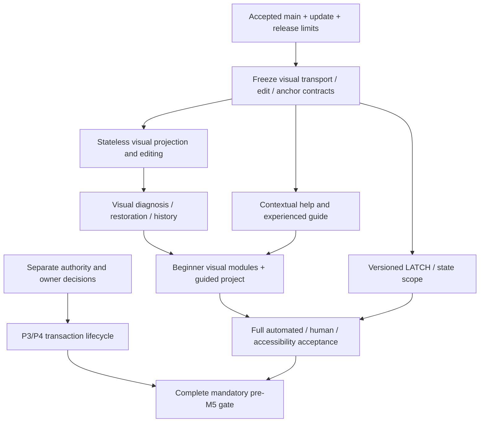

# Dependencies, risk, scope and implementation assignments

This is a planning handoff, not permission to start implementation during the audit. All eight capabilities remain mandatory. Codex is lead/integrator; OpenCode is independent fixture/acceptance/documentation support under AGENTS.md. Assignments below are future separate branches with disjoint write paths; no support agent was started in this audit.

## Dependency order

P3/P4 authority work is a separate critical path and excluded from this audit/first visual slice. Guide optional-deployment content must wait for that accepted implementation; boundary explanation can ship earlier. Existing read-only denial gates remain.

## Risk register

| ID / priority | Evidence and risk | Dependency / owner / mitigation and release gate |
|---|---|---|
| R01 Critical | P3 absent, P4 transaction controls absent; mandatory expanded gate cannot pass | Owner + Codex separate authority design/protocol/live evidence. No wallet/signing/broadcast here. Keep BLOCKED/PARTIAL until real acceptance. |
| R02 High | P7 conflicts with historical no-generic-canvas exclusion; new user update authorizes planning of narrow visual composer | Codex records additive ADR/product scope in implementation branch. Preserve verifier-first scope and all proof guards; do not edit immutable old constraints/evidence to erase conflict. |
| R03 High | `Component` union excludes LATCH; authoring semantics/state order/feedback undefined | Codex freeze versioned composition and trace boundaries. Render actual decoded latch structure honestly; no sequential `EQUIVALENT`. Decide authoring requirement before final P7 acceptance. |
| R04 High | Portable 1.1 forbids layout extras; hashes bind metadata | New single-file visual envelope + explicit version-aware dispatch, unchanged 1.1 embedded bytes/hash domains and loss-reporting downgrade. Codex owns contract; OpenCode tests new frozen spec. |
| R05 High | Two editor state copies or nondeterministic topological sort changes bytes | One canonical model, stable IDs/order, shared command controller; byte-identical existing import/open, web/table/CLI parity and explicit semantic revisions. |
| R06 High | Stale async diagnostics/corrections displayed/applied after edit/undo | Shared invalidation and operation tokens; actual reverify/apply bindings unchanged; adversarial delayed-response tests. |
| R07 High | Graph edges do not map 1:1 to binary connections due to nested REF/output copy NANDs | Side/path/hash-qualified overlay adapter, compiler-derived details, retain unmapped rows and ambiguity. Never infer unique defect. |
| R08 Medium | Graph-library peer/build/license unknown; paid examples differ from core | Exact-version isolated spike with React 19.3.1/TypeScript 7/esbuild, lock/notice review; own history implementation. Library docs are not compatibility proof. |
| R09 High | Node count != expanded gates; wide pins/hostile layout can overload browser | Separate visual profile/budgets and render bounds; collapse high-width ports with accessible index; keep core/network/trace ceilings. Measured Windows/Linux performance gate. |
| R10 High | Drag-only canvas/tour excludes keyboard, touch, screen readers | Equivalent table/inspector actions, stable focus, missing-anchor safe pause, reduced motion, real auditory trials. Existing axe results cannot certify new canvas. |
| R11 High | Guided Next/click/progress badge mistaken for actual operation success | Observe matching core results/artifact/revision identities, never forge consent or proof. Complete module 7 independent CLI replay and human session evidence. |
| R12 Medium | Progress/layout quota, incompatible version, unsaved drafts lost | Bounded independent progress schema; explicit file save, corrupt/blocked-storage recovery, version-aware resume; no fake durable backup claim. |
| R13 High | Recorded showcase or imported old evidence presented as CURRENT | Preserve RECORDED/HISTORICAL labels and exact engine pins; fresh read/compare separate. P8 screenshots tied to actual version, no invented UI. |
| R14 Medium | F03-PERF-001 and D-RUNNER-001 host-sensitive archival/runtime limits | Preserve 120-second historical assertions and all deadlines. Profile in scratch; retain failures. Do not mask by retry/skip/timeout increase. |
| R15 High | Release access/rights/human readiness unresolved despite PR #11 merge | Owner resolves license/content rights, organizer judge-access confirmation and rehearsal, novice install, auditory trial, captioned video/copy and entrant declarations. No agent contact/deployment/submission authorized. |
| R16 Medium | Exact baseline moves during audit/parallel work | Re-fetch, pin final baseline and protected-path equality. This audit advanced from b537eb6 to PR #11 merge 7ecfb9b; runtime source identical. Future branches start at latest approved integration SHA, never assume this report's SHA remains current. |

## Hackathon-critical versus deferred

| Scope | Decision / consequence |
|---|---|
| Preserve accepted engine, identity/manifest/witness/UNKNOWN/custody guards | Critical, never traded for UI delivery. Existing behavior is regression baseline, not rewrite target. |
| NAND/REF visual edit + real canary + correction/restore + canonical parity + single-file layout reopen | First critical technical slice. Does not complete mandatory latch representation or guide curriculum. |
| LATCH visual representation and explicit state support boundary | Mandatory P7. Actual stateful authoring/trace scope needs decision; defer implementation only with an explicit recorded incomplete gate or revised product scope. |
| Two tracks, seven modules, UX-01/02/03, module 7 artifact/replay | Mandatory P8. Deliver existing-control content early; visual lessons after P7. Do not count prose draft or static showcase as interactive completion. |
| P3/P4 transaction lifecycle | Mandatory expanded pre-M5 blocker, excluded from current authorized engineering scope. Deferring it means **pre-M5 is incomplete**, not optional. Need separate authority/project decision, no automatic start. |
| Rights, actual judge access/rehearsal, novice and auditory validation, captioned demo and owner submission approval | Release-critical external/human dependencies. PR #11 merge clears neither distribution nor submission. |
| Collaboration, cloud progress sync, arbitrary nested live editing, graph animations, automatic layout plugins, native installers, public solver hosting | Defer. No dependency on these for core visual/guide acceptance; public solver hosting prohibited here. |
| Unbounded stateful proof, speculative repair without trusted prior, second JS evaluator/SAT engine | Excluded. Do not implement as shortcuts. |

Planning ranges in P7/P8 are effort estimates, not calendar promises. They total substantial work beyond a single UI patch; do not commit to a hackathon date from historical documents. If time is insufficient, report unmet mandatory gates and choose an explicitly reduced demonstration with the owner. The audit does not verify current event rules or eligibility and supplies no new deadline claim.

## Assignment A — Codex: M4.6-A contracts and stateless visual parity slice

Start from final accepted integration/main SHA reverified at implementation admission (audit baseline `7ecfb9b74933eacb03f1b6ebf7c18a13fd02230f`). Read AGENTS, all audit documents, exact update snapshot and accepted M1–M4.5/release records. Work on a new `codex/flip-m46-visual-core` branch/worktree. Goal: a real NAND/REF visual adapter and versioned layout transport using one existing engine, followed by real diagnosis/restore. Do not start during this audit.

Allowed write ownership:

- `apps/web/src/**`, `apps/web/package.json`, `apps/web/package-lock.json`, `apps/web/build.mjs`, `apps/web/tsconfig.json` (only justified exact graph dependency/build integration).
- `apps/web/tests/visual-composer.spec.ts`, `apps/web/tests/guide.spec.ts`, `apps/web/tests/visual-portable.spec.ts` (new files; preserve inherited tests).
- `packages/flip-core/src/flip_core/visual_project.py`, `visual_project_schema_export.py`; existing `portable.py`, `workflow.py`, `verification.py` only for reviewed new-version dispatch that preserves frozen 1.1 semantics. Do not alter solver/evaluator/decoder behavior in this slice.
- `packages/flip-api/src/flip_api/app.py`, `packages/flip-cli/src/flip_cli/main.py` only for shared version-aware transport/open; no new network/write capability.
- `packages/flip-core/tests/test_m46_visual_project.py`, `packages/flip-core/tests/test_m46_visual_parity.py`.
- `docs/schema/m46-visual-project/**`, `docs/architecture/m46/**`, `docs/ux/m46/**`, `docs/milestones/M46_*`, `docs/evidence/m46-codex/**`; `.github/workflows/m1-contracts.yml` and `scripts/check_m46_visual.py` only for additive acceptance wiring.

Not owned: any existing schema version/golden, accepted fixture/archive/report, OpenCode namespaces below, root dependency/solver configuration or `.agents` skill changes. Root Python locks should not need changing. If new paths/contracts are needed, revise written ownership before editing; do not silently expand.

Freeze interface/transport/edit/event/anchor specs before asking OpenCode to build assertions. Start with M4.6-A0/A1; proceed through A2/A3 only when parity and trust gates pass. P7-S stateful authoring is a separate Codex assignment after semantics decision, with new versioned schemas and its own ownership addendum; never squeeze LATCH into frozen Component. P8 implementation later uses same Codex UI ownership, with content supplied by OpenCode through review.

Evidence: exact SHA, change list, graph-version/peer/license check, old/new canonical bytes, actual build/compare/witness/debug/correction/portable outputs, unchanged protected-path comparison, focused new tests then exact combined-head full Windows/Linux accepted suite/schema/custody gates and measured accessibility/performance. No fabricated raw evidence, paid-example copy, public solver, wallet, signer, broadcast or main merge. Stop for independent review with explicit unmet gates.

## Assignment B — OpenCode: independent visual/guide acceptance and curriculum

Use a separate `opencode/flip-m46-visual-guide-evidence` branch/worktree from the same agreed baseline. Read AGENTS and this audit. Goal: independent expected behavior, adversarial acceptance cases, accurate two-track lesson content and real manual test protocol. No production UI, schema, engine, global dependency, CI or shared test edits.

Exclusive allowed write ownership:

- `docs/evidence/m46-opencode/**` — source/provenance inventory, independent acceptance matrix, actual results/custody manifests; new raw observations must identify exact tested commit and environment.
- `docs/guide/m46-opencode/**` — experienced path, seven beginner modules, glossary, nine recovery lessons, proposed screenshots with source/hash/viewport provenance. All executable-control instructions wait for corresponding actual accepted behavior.
- `docs/acceptance/m46-opencode/**` — independent case specifications and human accessibility/usability protocols.

Do **not** add synthetic JSON directly under `fixtures/` without a separately reviewed new namespace/custody plan; PR #11's fixture-placement failure shows why. New standalone harnesses may be proposed as `.py.txt` under the owned evidence directory and executed from scratch after review. Archive immutable harness/results separately; do not overwrite captures on rerun or edit old corpus expectations. Codex alone wires reviewed acceptance into CI. Any runnable tests outside the owned docs namespace require a written ownership extension first.

Before Codex contract freeze: research requirements/primary-source concepts, enumerate actual controls, prepare test cases and curriculum drafts with future features explicitly blocked. After freeze: independent browser/CLI artifact parity, reversed/missing/duplicate pins, ordering, stale hashes, unknown visual versions, layout bounds/tamper, undo async races, ambiguous paths, stateful proof rejection, guide missing targets/progress corruption and all recovery lessons. A screenshot is not execution evidence. Do not simulate a novice or auditory tester and call it a human session.

Completion: commit/push own documentation/evidence branch, list exact tested target SHA, commands/results (including failures), source hashes, screenshots/artifact custody, missing human inputs and findings by severity. No edits to Codex paths, accepted fixtures or historical reports. Recommend PASS/PARTIAL/BLOCKED only for observed scope, not an unconditional P7/P8 completion claim. Codex reviews and integrates; no agent self-merges main.

## Final integration gate

Codex verifies disjoint diff paths and original blobs, reviews independent findings, integrates via reviewed commits, reruns appropriate tests on the exact combined tree and retains all failures/dispositions. P7/P8 accepted only after ACCEPTANCE.md gates and manual evidence; P1–P6 never weakened. Stop at this audit/planning handoff now. No implementation agents, transactions, hosting, release or submission are launched by these assignments.
