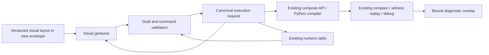

# P7 engineering architecture and staged plan

Status: **proposed**, not implemented or benchmarked. Baseline facts and missing pieces are in [CAPABILITY_MATRIX.md](CAPABILITY_MATRIX.md). Scope is a visual adapter to the accepted engine, never another circuit engine.

## Library decision

Primary documentation consulted 2026-11-23. This is a suitability inference, not a compatibility/performance result. No dependency installed by the audit.

| Option | Useful fit | Integration cost / decision |
|---|---|---|
| React Flow (`@xyflow/react`) | Controlled React graph, custom nodes and unique handles; built-in focus/selection support | Preferred conditional candidate. Test the exact chosen version's React 19.3.1 peer range, TypeScript 7/esbuild build, license and package contents before locking. App must implement domain constraints, accessible connect/reconnect and history. |
| Rete.js editor + React renderer | Socket editor, renderer plugins, history plugin | Feasible alternative; adds plugin integration. Do not enable its dataflow/control-flow engine. Benchmark rendering and keyboard connection workflow if React Flow fails the spike. |
| Cytoscape.js | Graph rendering/analysis and layouts, useful for large read-only dependency exploration | More application work for pin sockets, form controls and accessible authoring; not first choice for this React pin editor. |
| Custom React/SVG | Exact domain control; current sample already uses an SVG illustration | Full interaction, zoom, selection, routing, touch and accessibility maintenance falls to Flip. Keep only as fallback for a deliberately small diagram. |

Sources: [React Flow handles](https://reactflow.dev/learn/customization/handles), [accessibility](https://reactflow.dev/learn/advanced-use/accessibility), [performance](https://reactflow.dev/learn/advanced-use/performance), [MIT core license](https://github.com/xyflow/xyflow/blob/main/LICENSE); [Rete React renderer](https://retejs.org/docs/guides/renderers/react/), [history](https://retejs.org/docs/guides/undo-redo/), [separate engines](https://retejs.org/docs/concepts/engine/); [Cytoscape.js documentation](https://js.cytoscape.org/index.html). These sources support library capabilities; Flip suitability is this audit's design judgment.

React Flow's [undo/redo example](https://reactflow.dev/examples/interaction/undo-redo) is a **Pro-licensed example**, distinct from the MIT core. Implement Flip's own small command history; do not copy paid example source or assume undo is provided by the core. Avoid a paid-example dependency. Pin a tested release, retain applicable notices, and measure bundle cost. No automatic upgrade to whatever version current documentation describes.

## One executable model, two editors

`App.tsx` owns the committed execution request. Extract a shared edit/invalidation controller only in the implementation milestone; canvas and table issue the same domain commands. Graph-library objects and internal stores are projections, not a second persisted source of executable truth. UI validation is advisory; Python contracts and `compile_project` remain authoritative.

| Visual object | Accepted canonical mapping |
|---|---|
| External input bank | `candidate.nIn`; handle `out:<i>` maps to `{component:null,pin:i}`. Zero-based numeric labels remain visible. No semantic label inferred. |
| NAND node | `kind:NAND`, stable valid `instanceId`, exactly two ordered input slots, one output pin 0. |
| Imported REF node | `kind:REF`, `sourceAlias` binding validated Source/import/manifest; exactly nIn numeric inputs and nOut outputs. Alias/description cannot replace identity. |
| Connection to component input | Target instance plus `in:<j>` assigns `components[k].inputs[j]` the source `PinSource`. One driver per target; fan-out allowed. |
| Final output bank | Target `output:<j>` assigns `candidate.outputs[j]`; preserve explicit output order and comparison bijection. |
| Node coordinates/viewport/selection | Presentation only. Never serialize into executionRequest or use as proof identity. |

Example: edge from `xor/out:0` to `inv/in:1` becomes the second input of component `inv`: `{component:"xor",pin:0}`. Edge from external `out:1` to a REF's `in:0` becomes `{component:null,pin:1}` in that REF's first input. Display numeric pins even when a user supplies an explanatory alias; distinguish user labels from trusted protocol metadata.

Current models expose no constant PinSource; do not fabricate constant nodes because the binary format has constant signals. Adding constant authoring needs its own versioned recipe extension.

### Ordering and invalid drafts

Existing recipes are ordered DAGs: model validators reject forward/undefined/cyclic pins. Opening an accepted project preserves component array order and source/import order byte-for-byte. Dragging never reorders components. New rewire operations that require order changes use a stable topological sort, preserving prior ordinal among ties; preview resulting component order before commit. A new canonical order can change netlist/project identity, so it is a semantic edit requiring new comparison. Existing compiler handles final-output copy NANDs; browser does not generate netlist bytes or guess signal indexes.

Detached wires/new unbound nodes may exist only in a separately typed invalid draft. Report missing drivers, arity, bad direction, out-of-range pins, duplicates, cycles and missing imports by exact target. Disable build/compare/save-as-executable until complete. Never assign input zero silently. Validated commits retain width/map bijections; shrinking width or deleting a referenced node requires explicit incident-edge treatment and a reviewable diff. Keep last saved valid package intact. Unsupported larger projects remain openable through the existing table/file path rather than silently truncated into the visual profile.

### LATCH and stateful boundary

Current `tap02.decode` recognizes latch opcode 1 and permits bounded forward `d` references, and `execution.beat` evaluates state. Current `Component` union, composer, stateless comparison and debugger do not support latch authoring. Thus LATCH authoring is **MISSING**, not an existing feature awaiting an icon. The update explicitly requires visual representation of LATCH and placement of supported components: render genuine decoded LATCH structure with an honest stateful boundary. Decide whether unsupported latch editing is acceptable before P7 acceptance; do not silently interpret mandatory representation as full sequential equivalence.

Stage P7-S requires a new composition schema version defining `LATCH`, d pin, q output, explicit state ordering/initial state, legal feedback through state and deterministic encoding. Reuse the existing TAP-02 decoder/evaluator. Define a separate versioned bounded trace request/report if verification is needed: declared initial state, input sequence and k bound (eight beats is historical planning, not implemented acceptance). Trace matches prove only those traces; they cannot yield universal `EQUIVALENT`. Unbounded sequential equivalence is excluded. Stateless Canary must reject stateful roots/REFs, never drop state or render a green stateless verdict. Stateful diagnosis needs its own temporal path contract before enabling overlays.

First visual release may explicitly show LATCH as unsupported/read-only only if product scope permits; this leaves mandatory P7 incomplete. No mock latch action or fake proof. Clarify whether update requires editing only or bounded sequential verification before freezing P7-S. No accepted schema mutation.

## Undo/redo and proof invalidation

Use bounded commands for add/delete/reconnect, width/output changes, table edits, layout and verified-correction apply. A drag is one command at pointer-up, not hundreds of snapshots. Proposed maximum: 100 commands and 4 MiB in-memory history, with visible eviction notice and saved-file fallback. History capacity is separate from 1 MiB executable transport. New edit after undo clears redo. Project switch/import clears history with notice; progress survives independently.

Semantic commands invalidate built output, comparison, diagnostics, selected action and pending-result token using one controller. Undo/redo also invalidates; returning to identical bytes does not restore a cached proof badge. Layout-only moves preserve executable hash/result, but dismiss stale anchor positioning as needed. Any in-flight response must match current execution identity and operation generation before display. Do not carry debugger's one-step revert across unrelated edits. Correction apply still requires existing verify/reapply checks; history never bypasses them. Refresh restores a valid draft/package and layout but requires new proof replay/comparison; persisted history is deferred and disclosed.

## Layout alongside Portable Project 1.1

Accepted 1.1 has strict extra-field rejection and fixed metadata hash keys. **Do not add `layout` to its existing schema/model or reuse its version string.**

Required first contract: a new single-file `flip-visual-project-1.0.0` envelope containing an untouched Portable 1.1 package and a renderer-neutral `flip-visual-layout-1.0.0` section. A standalone sidecar is useful during research but **does not satisfy P7's portable-file requirement**. Layout fields: projectId, exact executionRequestHash, selected revisionHash, positions keyed by stable instanceId and reserved input/output bank IDs, bounded integer x/y coordinates, integer viewport x/y and zoom in thousandths, collapsed-node IDs. Coordinates finite bounded integers (propose ±1,000,000); max 5,002 positioned nodes, 256 KiB layout and short validated IDs; reject URLs/HTML/unknown kinds. The complete transport remains within 1 MiB. Validate against project before applying. Stale/unmatched layout is ignored with a notice, never used to change wiring. Opening JSON does not fetch a sibling path/URL.

Versioned open/export must preserve the entire visual envelope through web and CLI, with explicit extraction/downgrade and discarded-layout report for legacy export. Bind a new envelope digest to package plus layout without reinterpreting existing execution/evidence/revision hashes. Existing 1.1 consumers continue to reject the new outer version; new version-aware dispatch unwraps and invokes the accepted engine. Layout edits do not change embedded 1.1 revision hashes or confer freshness. Never hide coordinates in provenance strings. Source/import/evidence operations continue to enforce existing semantic identities.

## Connection diagnosis and Visual Wiring Canary

Call accepted compose/compare and then debug for an actual replayed DIFFERENT result. Bind overlay to `projectHash`, `executionHash`, diagnostic engine, source netlist hashes and current operation token. Use `Connection.side/path/connectionRef/instanceId/projectPin/inputPin/outputPin` to map connections to renderer IDs. Include reference/candidate side in keys; repeated/nested REF instances remain path-qualified.

Project-addressable connections select an edge and its table row in both directions. Nested child paths open a bounded read-only scope or detail panel. Compiler-created final-output NAND copies are shown as compiler-derived path detail; do not incorrectly attribute them to an editable project edge. Never match solely by binary element index or visible alias. Unmapped/truncated paths stay visible in the diagnostic table with a reason. Preserve 50-row paging and trace budgets until a separately reviewed change.

Use labels and line patterns as well as color for mismatched mapped outputs/relevant paths; terminology remains **relevant connection**, not “the broken wire.” Display ambiguous causes, selected-reference trust, historical scope and UNKNOWN. EQUIVALENT has no suspect set. Candidate corrections remain proposals until fresh verification, explicit selection/apply and new evidence. Visual hover/selection is explanation only; no client calculation of NAND/REF behavior, witness bits or solver verdict.

## Performance and accessibility targets (not observed results)

Initial editable visual profile: 200 component nodes, 400 rendered connections, 64 expanded visible handles per node. Collapse larger pin banks with indexed search/table access, never omit canonical pins. Do not equate rendered nodes with expanded gate count (core remains 2,500 default / 5,000 hard gate cap). Set limits before rendering hostile projects; preserve existing 1 MiB request, source closure, trace, deadline and memory controls.

On a documented reference Windows and Linux machine, collect 5 cold opens and 30 edit/drag samples: ≤1 s p95 projection/open for profile; ≤100 ms p95 local connect/undo feedback; ≥30 fps pan/drag; no edit long task >200 ms; ≤200 KiB added compressed initial JS (lazy-load canvas); ≤64 MiB incremental retained browser heap after repeated open/close, measured with a stated browser tool. These are proposed release gates, not source-derived promises. Record browser/version/hardware, graph/hash, medians/p95 and failure cases. Large-graph fallback must remain usable. Core solver budgets stay unchanged.

Memoize graph components/callbacks and subscribe narrowly; do not rebuild all nodes per pointer move. Begin with deterministic simple layout, no new automatic-layout dependency until justified. Defer nesting expansion, mini-map polish, collaboration and animated signal propagation.

Keyboard must add/select/connect/reconnect/delete/undo via a labeled inspector and table equivalent; dragging is optional. Provide visible focus, Escape cancel, correct text-field shortcut handling, announcements for accepted/rejected edits, no keyboard trap, 200% zoom and 320px panel fallback. Touch gets tap-to-connect and cancel/lost-pointer handling. Reduced motion removes transitions while preserving state feedback. Automated axe/keyboard tests plus real screen-reader and novice sessions are required; React Flow's accessibility features alone do not establish conformance.

## Stages and stop gates

| Stage | Deliverable | Exit evidence / dependency | Effort estimate |
|---|---|---|---|
| M4.6-A0 | Freeze update traceability; graph, single-file visual envelope, history and guide-anchor contracts; isolated library spike | All requirement IDs mapped; React/build/license/performance smoke; accepted fixtures untouched | 1–2 focused days |
| M4.6-A1 | Read-only projection + numeric table synchronization | Existing sample roundtrip identical request/netlist hashes; source pin/edge mapping tests, keyboard equivalent | 1–2 days |
| M4.6-A2 | Validated NAND/REF edits + undo/redo + save/reopen layout | Rewire/order/deletion/invalid draft tests; web/CLI canonical parity and late-result rejection | 2–3 days |
| M4.6-A3 | Visual Canary + bound diagnosis/correction | Real DIFFERENT witness, ambiguous paths, verified explicit correction/revert, historical replay | 1–2 days |
| P7-S | Versioned LATCH authoring and bounded-state scope if required | Frozen new contracts, official sequential vectors and stateful rejection/trace tests; independent review | 3–5+ days after semantics clarified |
| M4.6-A4 | Performance/accessibility + regression/custody acceptance | Exact combined-head Windows/Linux CI; measured budgets and manual trials | 1–2 days plus human availability |

Estimates are planning ranges, may overlap with independent fixtures/docs only, and do not commit a date. Compatibility failure or inability to keep canonical parity blocks the dependent stage. Do not broaden into transaction lifecycle or public hosting.
