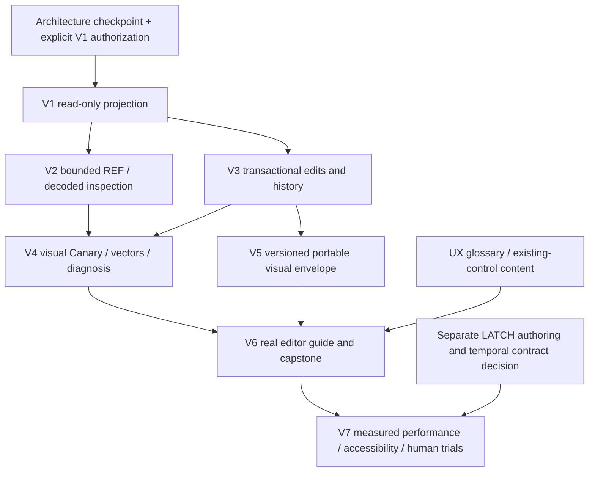

# Dependencies, security, acceptance and ownership

Only this documentation checkpoint is authorized now. Each implementation stage needs its own small reviewed PR. Explicit authorization for V1 remains pending. Do not merge any implementation stage without unchanged core behavior, stage acceptance, Windows/Linux CI, canonical/evidence invariants and independent review free of blocking findings.

## Dependency graph

P3/P4 transaction work remains blocked/separate and prohibited here. Optional auto-layout follows measured need after V5, not the critical path. Existing stateless proof semantics remain unchanged throughout.

## Small PR stages and acceptance tests

All new editor/guide tests below are **NOT TESTED**. Baseline checks are in BASELINE.md. Proposed names identify future tests, not files created by this checkpoint.

| Stage | Scope / files allowed by that stage | Exit tests and retained evidence |
|---|---|---|
| V1 read-only sample | Adapter projection + Visual pane on Composition, no new API/schema, no semantic editing. Candidate NAND/REF, external/output banks, selected pin inspector, zoom/fit/table access. Add only tested exact renderer dependency. | `visual-readonly.spec.ts`: open actual historical sample; node/edge IDs resolve exact recipe; all ports/order/output maps retained; switch Advanced unchanged; source/manifest/request/netlist hashes equal before/after; keyboard focus/zoom; no network beyond existing operations; no proof shown merely by render. Golden projection contract cases cover zero inputs, multioutput REF and high IDs. React 19.3.1/TS7/esbuild/Strict Mode compatibility spike. |
| V2 imports and REF scopes | Read-only import/dependency visualization via existing importer; separately reviewed bounded decoder projection API only if current data is insufficient. Preserve unresolved/stateful original bytes. | Genuine recorded circuit bytes with HISTORICAL labels, chain/hash/provenance; repeated/nested REF distinct paths; malformed/cyclic/budgeted closure rejected; LATCH represented read-only, no EQUIVALENT; unresolved placeholders never silently lost. New backend route must receive full guard/parity tests. |
| V3 editable canonical graph | Add/configure/connect/reconnect/delete NAND/stateless REF; incomplete drafts; shared table commands; bounded undo/redo and safe restore. | `visual-edit.spec.ts`: mouse drag and keyboard/tap wiring compile same netlist as table/CLI; invalid direction/width/driver/cycle/forward reference, destructive edit cancellation, fan-out, pin shrink, reordered graph diff, undo/redo branching/eviction, stale validation after edit/cancel/switch. Actual Python compilation decides acceptance. |
| V4 visual Canary/simulation | Existing vector/compare/debug APIs; baseline/mutation snapshot, mapping diff, bound relevant paths, original restore/reverify; no internal-wire-value fabrication. | `visual-canary.spec.ts`: real DIFFERENT witness + independent replay; mapped bits, nested paths, ambiguity, UNKNOWN/timeout, forged/stale payload rejection; reliable correction fresh verify/apply; one-action restore + new EQUIVALENT; superseded responses never overwrite revisions. |
| V5 portable visual project | New versioned envelope/open/export/extract path and new schema only; full web/CLI transport. | Exact request/netlist hashes unchanged by layout; layout survives web→CLI→web; unknown versions and malformed/huge/float/URL/stale layout reject or safely fallback without semantic mutation; explicit loss report; old schemas/goldens unchanged; missing evidence stays missing; wrong engine fails honestly; entire file ≤1 MiB. |
| V6 guide and three UX systems | Dedicated entry, two paths, seven modules, term catalog, stable anchors, safe progress and nine recovery lessons. | `guide.spec.ts`: every live control anchor unique; next/back/exit/focus; missing/moving/disabled control safe pause; failed/UNKNOWN operation cannot complete; quota/corrupt/version/project mismatch resume; no auto consent/trust/apply; all nine lessons preserve originals; module 7 exports actual project/evidence and independent CLI replay. |
| V7 quality and acceptance | Measurements, actual human trials and focused fixes on combined implementation SHA. | Normal 100/200 and stress 500/1000 graph runs, keyboard-only wiring, mouse/touch/pointer cancel, real screen-reader speech, forced colors, 320/390px/desktop, 200/400% zoom, reduced motion, save/reload and unsaved recovery. At least one novice + experienced developer; document actual failures and fixes. Full unchanged Windows/Linux suites/schema/canonical/custody/credentials plus all new tests. |

Separate stateful PRs require explicit approved scope, versioned authoring/state order/initial-state/feedback rules and existing evaluator integration. Any bounded trace results describe exact sequences, not unbounded equivalence. V1 does not complete P7/P8. V7 cannot claim full P7 if unresolved mandatory LATCH representation/portability/guide work remains.

## Benchmark protocol and limits

The directive's **100 nodes/200 edges normal** and **500/1,000 stress** are representative test targets; prior audit 200/400 is superseded as a planning profile. Expanded gate/depth limits are independent from visible graph count. Build recipe graphs with legal driver cardinality; add wide/nested REF cases, because easy chains understate DOM/port cost. Benchmarks must identify whether graph is rendered recipe or expanded read-only scope.

For exact graph hashes and fixed Windows/Linux hardware/browser versions: five cold opens and thirty representative edits/undo/drag/zoom samples; report median/p95 projection and feedback latency, frame timing/long tasks, render counts, retained heap after 20 open/close cycles and stale-response correctness under delayed solver results. Proposed normal gates: p95 local feedback ≤100ms, opening ≤1s, drag/pan ≥30fps, no routine interaction task >200ms. Proposed stress gates: no crash/data loss, cancellation/navigation remains usable, >100ms work chunked/worker-assisted or bounded fallback; document degraded-mode threshold rather than claiming 500 nodes production-ready. Heap target ≤64 MiB incremental retained after cycles and ≤200 KiB added compressed initial JS are hypotheses to validate. Do not substitute these for native 5s/64MiB proof-worker budgets.

If threshold exceeded, show bounded read-only/subset navigation and numeric/table/CLI path; never truncate exported semantics or disable validation. Layout computation, if later added, has cancellation/generation checks and ≤1s proposed budget with manual fallback. A layout worker computes coordinates only.

## Security and accessibility threat assessment / risk register

| ID / severity | Threat or dependency | Mitigation / gate / owner |
|---|---|---|
| T1 Critical | Graph callback bypasses canonical checks or creates second evaluator | Python validator/compiler only authority; direct hostile API tests; Codex V3/V4. |
| T2 High | Alias/label/provenance spoofing or HTML injection | Escaped text, exact chain/processor/ID/netlist/environment bindings; imports freshly validated; no HTML/URL content in layout; Codex + independent hostile cases. |
| T3 High | Async response or verified action applies to newer revision | Hash + generation + project session binding, cancellation, fresh apply check and undo invalidation; V3/V4 race tests. |
| T4 High | Layout treated as executable meaning / silent schema break | New envelope/version, fixed 1.1 hash domains, explicit downgrade; coordinates never affect wire endpoints; V5 cross-interface tests. |
| T5 High | Lost unresolved/stateful content or false stateless proof | Read-only placeholder/state badge and preserved bytes; unsupported editing denied; new temporal contracts required; V2/state decision. |
| T6 High | Root-cause/value claims exceed debugger evidence | Distinguish relevant cone, ambiguous causes, mapped output witness and unobserved internal signals; retain truncation/table fallback; V4. |
| T7 High | Hostile huge graph/width/history/layout exhausts browser | Bounded parse/ports/render/history, worker/cancel where justified; no core cap increase; normal/stress benchmarks and leak test; V7. |
| T8 High | Keyboard-only or screen-reader user cannot connect/restore | Full inspector/table alternatives, semantic labels, focus return, missing-target safe pause, real auditory trial; V1 onward. Library a11y ≠ app acceptance. |
| T9 High | Drag/tour captures page scroll, pointer lost, focus trap/hidden warning | Touch-action scoped to handles, pointercancel cleanup, nonmodal instruction panel, always available Exit; physical/emulated evidence distinguished. |
| T10 High | Guide progress fabricates success, stale proof or destructive reset | Actual operation events/artifacts, separate bounded learning data, project/version validation; no auto permission; all nine recovery lessons on copies. |
| T11 Medium | React Flow/Rete or example licensing/toolchain mismatch | Exact package/peer/notices review and compile spike; no Pro hooks/noncommercial plugin; provisional choice can be rejected. |
| T12 High | Credentials/network/public exposure introduced for convenience | No arbitrary URLs, no new write methods, existing loopback/Host/origin/opt-in/slots retained; no live transactions/deployment/public solver. |
| T13 High | False UX acceptance from machine/simulated learner | Real novice and experienced trials plus screen reader; retain abandoned tasks/assistance; no recruitment/contact by tools without instruction. |
| T14 Medium | Requested .md requirements absent / old constraint says no canvas | Use exact supplied TXT provenance; new user directive authorizes narrow planning, preserve historical exclusion record; later additive ADR approved before implementation. |
| T15 High | Release assumed clear because merge succeeded | Rights, judge access, novice install, human accessibility, final materials and owner release authority remain external dependencies. No milestone promotion. |

## Exact non-overlapping future ownership

This checkpoint writes only `docs/planning/visual-architecture/**`. The following are assignments for **separate implementation branches after authorization**, not agents launched now. Parent baseline must be refreshed and identical for both.

### Codex: V1 read-only implementation

Branch `codex/flip-visual-v1`. Exclusive writes:

- `apps/web/src/visual/**` (new adapter/components/view CSS); `apps/web/src/App.tsx`, `Composer.tsx`, `style.css` for minimal composition-local integration only.
- `apps/web/package.json`, `apps/web/package-lock.json` for exact reviewed renderer package; no Python/root dependency changes.
- `apps/web/tests/visual-readonly.spec.ts`, `apps/web/tests/visual-adapter.spec.ts` (new tests); `docs/ux/visual-v1/**` and `docs/milestones/VISUAL_V1_HANDOFF.md`.

V1 forbids core/API/CLI/schema edits, existing-test/fixture/archive rewrites, simulation/proof changes or new routes. Any additional path needs a written ownership revision. V2–V7 each add explicit reviewed ownership for their own backend/schema/guide paths before work; these are not implicitly authorized by V1. Codex alone owns shared interfaces/CI integration. Read the earlier [full handoff](../pre-m5/HANDOFF.md) for future package transport and guide ownership; this narrower V1 assignment takes precedence for the first PR.

Completion: exact commit/package versions, before/after canonical checksums, new tests + existing web/core regression, Windows/Linux CI, unchanged protected paths, independent review and known limitations. Keep PR unmerged until gates met.

### OpenCode: independent V1 research/acceptance

Branch `opencode/flip-visual-v1-review`. Exclusive writes:

- `docs/evidence/visual-v1-opencode/**` for independent cases/results/source manifests; harness proposals archived as `.py.txt`/`.mjs.txt` and run from scratch with recorded commands.
- `docs/acceptance/visual-v1-opencode/**` for keyboard/screen-reader/normal/stress test protocols.
- `docs/guide/visual-v1-opencode/**` for accurate glossary/two-track curriculum drafts, clearly marked future editor actions.

No production/CI/dependency/schema or shared test writes. No new synthetic corpus in restricted `fixtures/` namespace; Codex reviews/wires accepted new tests. Before V1 interface freeze: source/lesson research only. After freeze: black-box exact canonical pin/edge/order/unsupported/identity cases and negative observations against exact target commit, not a UI-presence checklist. Report failing results unchanged, severity, hashes, actual human sessions or their absence and scope-limited recommendation. No simulated human test, own-main merge, or interaction with third parties.

Codex integrates only after disjoint-path check and independent review. No agent is authorized to weaken a failing test, custody assertion, deadline, permission guard or historical result.

## Open decisions at checkpoint

1. Approve V1 alone with provisional React Flow 13.0.2 subject to compatibility tests; no broad implementation.
2. Define actual LATCH authoring/temporal-simulation scope separately from mandatory visual representation.
3. Accept the new visual envelope strategy before V5; do not silently mutate Portable 1.1.
4. Choose benchmark reference hardware and recruit real novice/experienced/assistive testers through the owner.
5. Decide optional auto-layout only if measured navigation pain justifies package, license and performance cost.

Stop here. User authorization for stage V1 is the next action; all preparatory research/specifications are delivered for that decision.
